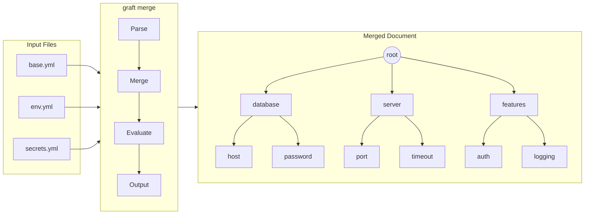

# Graft

Grafting YAML Trees for plentiful satisfactions.



## Introduction

`graft` is a general purpose YAML & JSON merging tool designed to be an intuitive utility for merging configuration templates together to generate complex config files in a repeatable fashion.

Use graft to:

- Stitch together generic/top-level definitions with site-specific overrides
- [DRY](https://en.wikipedia.org/wiki/Don%27t_repeat_yourself) up your configurations
- Manage secrets from Vault, AWS, or NATS
- Generate environment-specific configurations from templates
- Compare generated configurations semantically rather than line by line

## Features

- **Spruce Compatible**

  Runs spruce's operators, CLI flags, and merge semantics; the remaining
  differences are tracked in [Known Gaps](docs/spruce/known-gaps.md)

- **48 Operators**

  References, strings, arithmetic, comparison and boolean logic, arrays,
  external sources, and IP arithmetic

- **Control Flow**

  `if`/`elif`/`else`, `for`, `while`, and `case` blocks, expanded into plain
  YAML before the document is parsed

- **Multi-Backend Secrets**

  Vault, OpenBao, AWS Parameter Store, AWS Secrets Manager, NATS JetStream

- **Named Backend Targets**

  Route one lookup at a named backend with `(( vault@production "secret/db:password" ))`

- **Semantic Diff**

  `graft diff` reports structural changes — added, removed, and changed
  paths — instead of a textual diff

- **Fast, With an Opt-In Persistent Cache**

  Heavy merges run several times faster than spruce; set
  `GRAFT_CACHE_L2_ENABLED=true` to also cache across runs, replaying
  byte-identical repeat merges near-instantly
  ([details](docs/features/extras.md#caching))

- **Built-In jq**

  `graft jq` runs jq programs over JSON and YAML with graft's own engine,
  and a link named `jq` makes graft answer to jq's name
  ([details](docs/user-guide/jq.md))

- **Built-In yq**

  `graft yq` runs yq expressions over YAML and JSON with graft's own engine and keeps comments and styles, and a link named `yq` makes graft answer to yq's name ([details](docs/user-guide/yq.md))

- **Embeddable Go Library**

  `pkg/graft` - embed configuration merging in your applications

## Quick Start

```sh
# Create a base configuration
cat > base.yml << 'EOF'
database:
  host: localhost
  port: 5432
server:
  timeout: 30
EOF

# Create an environment overlay
cat > prod.yml << 'EOF'
database:
  host: db.prod.example.com
server:
  timeout: 60
  ssl: true
EOF

# Merge them together
graft merge base.yml prod.yml
```

**Output:**

```yaml
database:
  host: db.prod.example.com
  port: 5432
server:
  ssl: true
  timeout: 60
```

## Installation

### Using Homebrew (macOS)

```sh
brew trust fivetwenty-io/tap &&
  brew install --cask fivetwenty-io/tap/graft
```

### Using Go

```sh
go install github.com/fivetwenty-io/graft/cmd/graft@latest
```

### Pre-built Binaries

Download from the [releases page](https://github.com/fivetwenty-io/graft/releases/) for:

- Linux (amd64, arm64)
- macOS (amd64, arm64)
- FreeBSD (amd64, arm64)
- Windows (amd64)

### From Source

```sh
git clone https://github.com/fivetwenty-io/graft.git
cd graft
make build
```

For detailed installation instructions, see the [Installation Guide](docs/getting-started/installation.md).

## Go packages

The jq and yq engines are importable too. `pkg/jq` compiles and runs jq programs, `pkg/yq` does the same for yq expressions while keeping the comments, styles, anchors, and tags of the YAML it reads, `pkg/query/value` holds the values they read and produce, and `pkg/query` holds the errors a run can end with. The regular expression engine lives in `pkg/regex`, exact decimal arithmetic in `pkg/decimal`, and key ordering in `pkg/sortkeys`. These packages are experimental until graft jq and graft yq are complete, so their exported names may still change between minor releases, and the changelog lists every such change.

```go
q, _ := jq.Compile(`.items[] | select(.n > $min) | .name`, jq.WithArg("min", value.Num(1)))
in, _ := jq.NewDecoder(os.Stdin, jq.DecodeOptions{}).Next()
out, _ := q.RunAll(context.Background(), in)
enc := jq.NewEncoder(os.Stdout, jq.EncodeOptions{Raw: true})
for _, v := range out { _ = enc.Encode(v) }
enc.Flush()
```

The yq package has the same shape. Here `Eval` runs the expression once for each document, and `EvalAll` runs it once with every document in the candidate set, the way yq's `eval` and `eval-all` do.

```go
ev, _ := yq.Compile(`.a = 2 | .b += ["y"]`)
doc, _ := yq.NewDecoder(os.Stdin, yq.DecodeOptions{}).Next()
enc := yq.NewEncoder(os.Stdout, yq.EncodeOptions{})
for v, err := range ev.Eval(context.Background(), doc) {
	if err != nil { log.Fatal(err) }
	_ = enc.Encode(v)
}
enc.Flush()
```

The options on `pkg/yq` stand for yq's flags. `WithEnvOps(false)`, `WithFileOps(false)`, and `WithSystemOps(true)` are the three `--security-*` flags, and `WithFloatNumbers`, `WithStringInterpolation`, `WithHeaderPreprocess`, and `WithMergeAnchorFix` are the flags of the same names. `ExitCode` gives the code yq would exit with, where `-e` fails only when nothing was produced or every output was null or false.

Every exported name in these packages has a runnable example in its Go documentation, and the `pkg/jq` and `pkg/yq` overviews each walk through a complete read, run, and write loop.

## Documentation

Comprehensive documentation is available in the [docs/](docs/) directory:

- **[Documentation Hub](docs/index.md)**

  Start here for an overview of all documentation

- **[Getting Started](docs/getting-started/)**

  Installation, quick start tutorial, and Spruce migration guide

- **[jq, yq, and aliases](docs/user-guide/jq.md)**

  Running jq programs with `graft jq` and yq expressions with `graft yq` ([yq guide](docs/user-guide/yq.md)), and `graft install-aliases` for the `jq`, `yq`, and `spruce` names

- **[User Guide](docs/user-guide/)**

  CLI commands, operators, secrets management, and configuration

- **[Developer Guide](docs/developer-guide/)**

  Library API reference, custom operators, embedding, and testing

- **[Architecture](docs/architecture/)**

  Processing pipeline, parser design, and parallel execution model

- **[Examples](docs/examples/)**

  Practical examples for common use cases

- **[Reference](docs/reference/)**

  Quick references, environment variables, error codes, and glossary

## Operator Quick Reference

All 48 registered operators:

| Category | Operators |
|----------|-----------|
| Reference | `grab` |
| String | `concat`, `join`, `split`, `stringify`, `base64`, `base64-decode` |
| Data | `keys`, `type`, `empty`, `null`, `negate` |
| Arithmetic | `+`, `-`, `*`, `/`, `%`, `calc` |
| Comparison & Logic | `==`, `!=`, `<`, `>`, `<=`, `>=`, `&&`, `\|\|`, `!`, `? :` |
| Array | `sort`, `shuffle`, `flatten`, `uniq`, `cartesian-product`, `cartesian` |
| Secrets | `vault`, `vault-try`, `awsparam`, `awssecret`, `nats` |
| External Sources | `file`, `load`, `raw_env` |
| Merge structure | `inject`, `prune`, `param`, `defer` |
| IP arithmetic | `ips`, `static_ips` |

Two families sit outside that count. The array-merge markers — `append`,
`prepend`, `replace`, `inline`, `merge`, `merge on <key>`, `delete` — are
handled by the merger while documents are combined. The control-flow
keywords — `if`/`elif`/`else`/`fi`, `for`/`done`, `while`/`done`,
`case`/`when`/`default`/`esac`, and `range` — are expanded by a
source-to-source preprocessor before the YAML is parsed.

See the [Operator Reference](docs/reference/operators.md) for complete
documentation, or the [Operator Quick Reference](docs/reference/operator-quick-reference.md)
for syntax at a glance.

## Origins

Graft was originally forked from Geoff Franks's excellent [Spruce](https://github.com/geofffranks/spruce) tool to add additional features. After significant refactoring and the addition of new capabilities, it has grown into its own tool with a different focus and expanded use cases.

Graft aims to run any valid Spruce configuration unchanged, and adds
capabilities Spruce does not have — control flow, infix expressions,
`field=value` predicates, named backend targets, and the NATS backend among
them. The differences that remain are catalogued in
[Known Gaps](docs/spruce/known-gaps.md).

## Contributing

We welcome contributions! Please see [docs/contributing.md](docs/contributing.md) for guidelines, and [CONTRIBUTORS.md](CONTRIBUTORS.md) for the people behind Graft.

## License

Licensed under [the MIT License](LICENSE).
